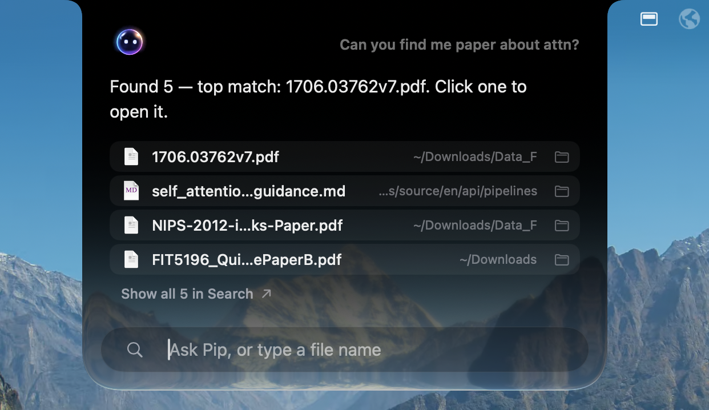
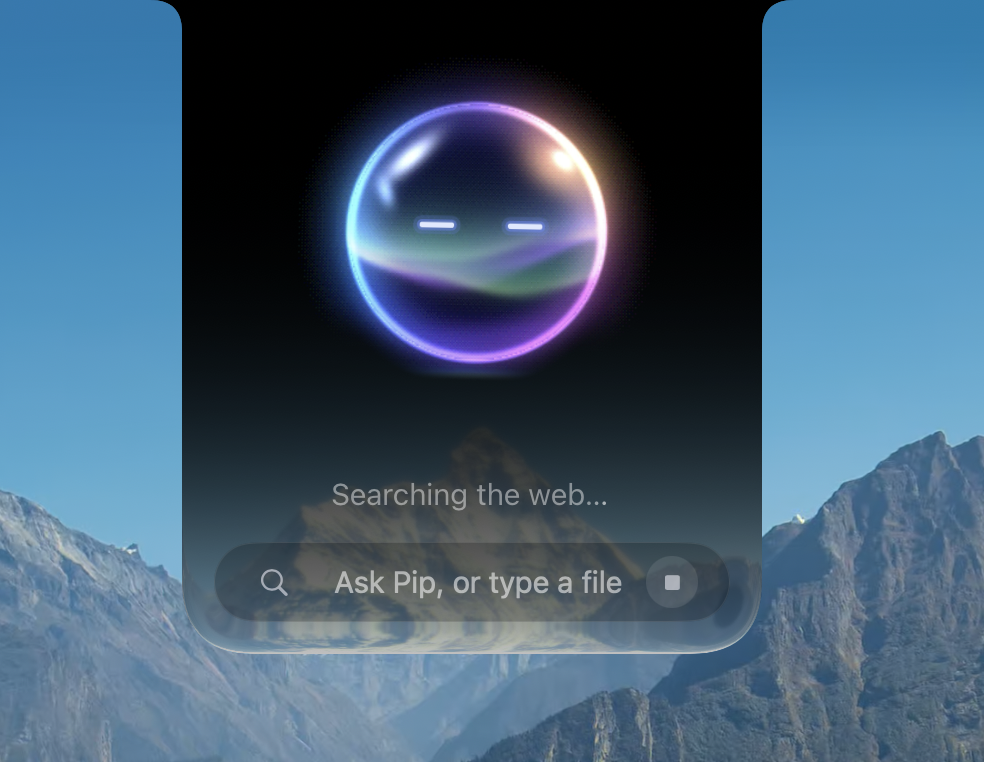
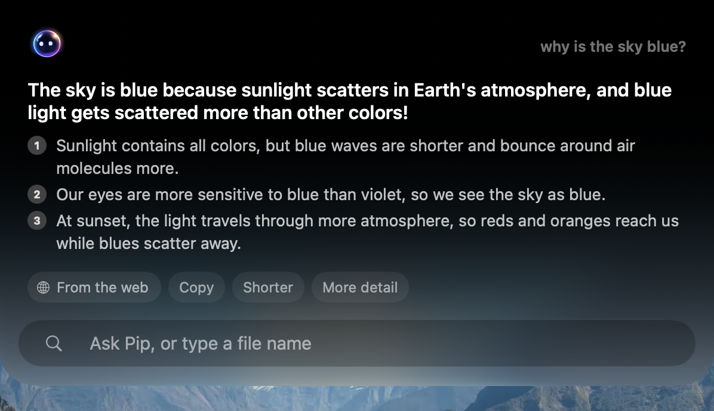

<div align="center">


# Pip

**An AI that lives in your MacBook notch and knows your files.**<br>
Fully on-device — nothing you ask, say or keep leaves your Mac.

<p>
  
  
  
  
  
</p>


[Files](#-finds-anything-understands-everything) ·
[Ask](#-ask-him-anything) ·
[The island](#-the-island) ·
[How it works](#-how-it-works) ·
[Build](#-build-it)

</div>

---

## ✨ Why Pip

<table>
<tr>
<td width="33%" valign="top">

### 🔒 Private
The brain, the voice, the search and every index run on your Mac. Only web searches you ask for touch the network.

</td>
<td width="33%" valign="top">

### 🧠 Understands files
Pip reads your documents and says what each one *is* — no fixed categories — so "research papers" finds papers, whatever they're called.

</td>
<td width="33%" valign="top">

### 🗣️ Talks back
Ask by typing or by voice. He answers in his own voice, with clear layouts for explanations.

</td>
</tr>
</table>

---

## 📂 Finds anything, understands everything

<table>
<tr>
<td width="55%"></td>
<td valign="top">

**Every document gets a line in Pip's own words** — *"RLHF paper on summarizing from feedback"*, *"Week 7 slides on research methods"* — from its text, name, folder and neighbours.

That line is searchable, shows under each result, and groups results by kind: **Papers**, **Slides**, **Receipts**… named by Pip, not hardcoded.

</td>
</tr>
</table>

- **Ask in your own words** — *"paper about attn"*, *"the rent receipt from March"*, *"slides I downloaded last week"*. Typos, abbreviations, dates and folders all work.
- **Answers from inside files** — *"how much rent did I pay last month?"* is read from the documents themselves.
- **Keeps things tidy** — move, copy, rename, find duplicates, suggest better names, and organise a folder into folders named after what's in them. Everything can be undone.

<div align="center">

</div>

---

## 💬 Ask him anything

<div align="center">
<table>
<tr>
<td align="center"><br><sub><b>Listening</b> · ⌥V</sub></td>
<td align="center"><br><sub><b>Thinking</b></sub></td>
<td align="center"><br><sub><b>Searching the web</b></sub></td>
</tr>
</table>
</div>

Questions, facts and conversions go through a web search first, so answers are current — laid out as a headline, a paragraph and points, with pictures when they help.

<div align="center">


</div>

Plus the everyday jobs: volume, apps, music, timers, notes, screenshots, and summarising long text you copy. **Click to ask** (⌥⇧A) explains any picture or text on screen in a panel beside it.

---

## 🏝️ The island

<div align="center">

</div>

Hover the notch for search, now playing, and your recent screenshots. The island also shows charging and low battery, finished downloads (with an offer to rename or file them), and a shelf to park files on and drag out later.

### Shortcuts

| Keys | Does |
|---|---|
| <kbd>⌥</kbd> <kbd>F</kbd> | Search files |
| <kbd>⌥</kbd> <kbd>V</kbd> | Talk to Pip (again to stop) |
| <kbd>⌥</kbd> <kbd>⇧</kbd> <kbd>A</kbd> | Click to ask |
| <kbd>⌃</kbd> <kbd>⎋</kbd> | Stop whatever Pip is doing |

---

## ⚙️ How it works

| | |
|---|---|
| **Brain** | Qwen3.5-9B (4-bit) on [MLX](https://github.com/ml-explore/mlx-swift), with its own tool loop — Ollama as a fallback |
| **Voice** | Kokoro-82M, vendored in `Pip/Voice/Kokoro` |
| **Listening** | Apple's on-device speech recognition (`SpeechAnalyzer` on macOS 26) |
| **Eyes** | Qwen3.5's vision encoder, for screenshots and photos |
| **Search** | Spotlight + SQLite FTS5 (BM25) + Apple sentence embeddings + MobileCLIP |

<details>
<summary><b>How search finds a file</b></summary>
<br>

1. **Understand the query** — words, file type, time ("last month") and folder.
2. **Ask every source at once** — known names (instant), Spotlight, the full-text index, meaning, and photos by how they look.
3. **Rank** — name match, text match (BM25 or meaning), recency, how often it's opened and type, weighted; files holding every word go first.
4. **Read more only if needed** — unread files are opened and scored, going back in time until there's an answer.
5. **Describe and group** — results Pip hasn't described yet are described on the spot, and the list regroups by kind as each line lands.

Results update live: names in ~60 ms, the rest within a second.

</details>

---

## 🛠️ Build it

**Needs** a MacBook with a notch and Apple silicon, macOS 14 or later (Liquid Glass and the newer speech model need macOS 26), and ~7 GB of disk for models downloaded on first use: brain ~6 GB, voice ~330 MB, MobileCLIP ~200 MB.

1. Open `Pip.xcodeproj`
2. Choose your Team under **Signing & Capabilities**
3. Run with <kbd>⌘</kbd> <kbd>R</kbd> — the only package, `mlx-swift`, is fetched by Xcode

Optional, so the island sees music and video in browsers:

```sh
brew tap ungive/media-control && brew install media-control
```

`Scripts/install.sh` builds a Release copy into /Applications.

<details>
<summary><b>Permissions</b></summary>
<br>

macOS asks for each the first time it's needed:

| Permission | For |
|---|---|
| Microphone, Speech Recognition | Talking to Pip |
| Screen Recording | Pip looking at your screen, click to ask |
| Accessibility | Click to ask, media keys |
| Automation | Music and Spotify, Notes, Mac settings you ask him to change |

</details>

<details>
<summary><b>Where data lives</b></summary>
<br>

- `~/Library/Application Support/Pip/` — models, search indexes, descriptions, conversations
- `~/Library/Caches/Pip App/` — caches
- `~/Library/Logs/Pip/` — a daily activity log

</details>

---

<div align="center">

**MIT** — see [LICENSE](LICENSE). The vendored Kokoro code and the downloaded models keep their own licences.

<sub>Made by Himanshu</sub>

</div>
