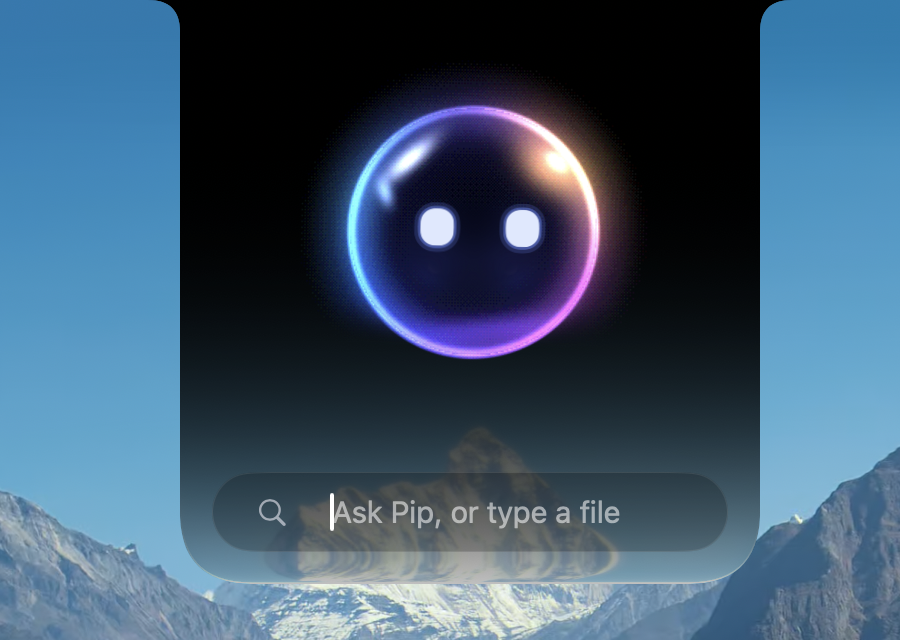
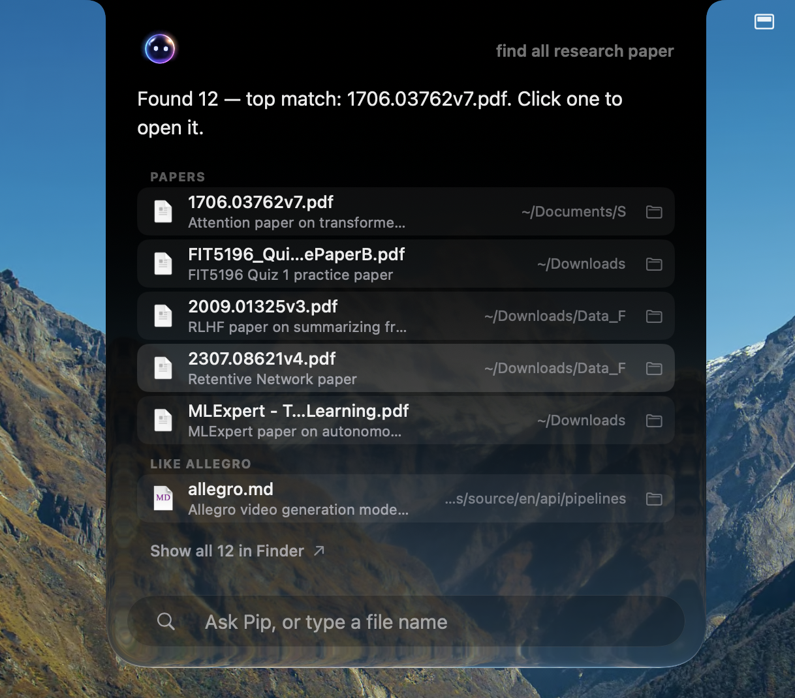
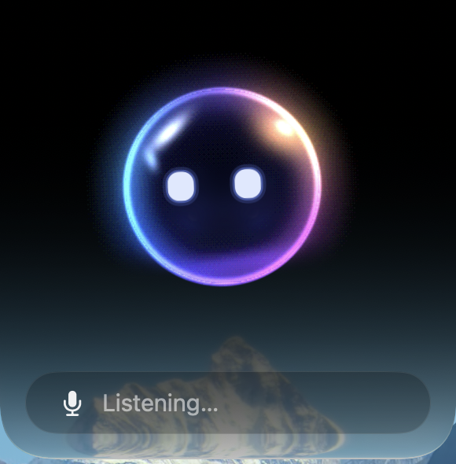
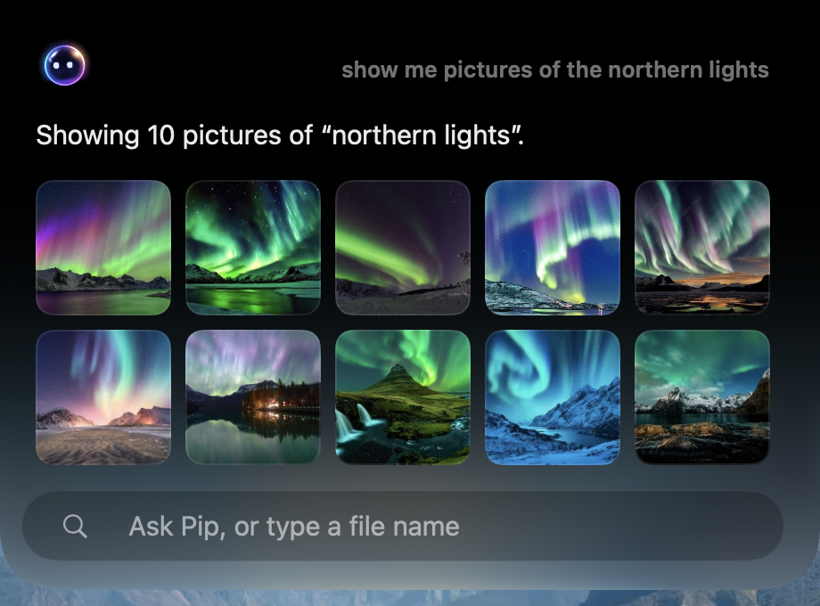
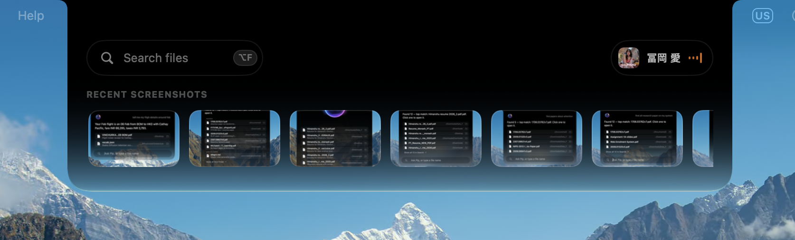

# Pip

Pip turns the MacBook notch into a small live island, and lives in it: an
AI helper that runs entirely on your Mac. His main job is your files —
finding them, understanding what they are, keeping them tidy and telling you
what's in them.

Nothing you ask, say or keep leaves the Mac. The only things that use the
network are web searches, pages Pip reads for you, and the one-time model
downloads.

<p align="center">
  
</p>

## Files, understood

Pip doesn't sort your files into a fixed list of categories. He reads each
document and says in a line what it is — "RLHF paper on summarizing from
feedback", "Receipt for a phone case", "Week 7 slides on research methods" —
from its text, its name, its folder and the files beside it. That line is
searchable, shows under the file in results, and decides how results are
grouped and how folders are organised.

<p align="center">
  
</p>
<p align="center"><sub>"find all research paper": grouped by what Pip says each file is</sub></p>

- **Ask in your own words.** "find papers about attn", "the rent receipt from
  March", "slides I downloaded last week". Abbreviations, typos, dates and
  folders are understood.
- **Described on the spot.** Results Pip hasn't read yet are described as
  you look at them, and the list regroups as each line lands. The rest of
  your documents are described while the Mac is idle and plugged in.
- **Grouped by kind.** Results that are the same kind of file (papers,
  slides, receipts…) are shown together under a name taken from Pip's own
  descriptions.
- **Answers from inside files.** "how much rent did I pay last month?",
  "when is my flight?" — read from the documents themselves, with the files
  shown below the answer.
- **Tidying.** Move, copy, rename, collect into a folder, find duplicates,
  suggest better names, organise a folder into folders named after what's in
  them. Everything he changes can be undone. Apps are never moved or renamed.

<p align="center">
  
</p>

## Everything else

<p align="center">
  
  
  
</p>
<p align="center"><sub>Listening (⌥V) · thinking · searching the web</sub></p>

**Pip, in the notch**
- Ask by typing or by voice (⌥V to talk, again to stop). He answers in his
  own voice, with explanations laid out as a headline, a paragraph and points.
- Questions, facts and conversions go through a web search first
  (DuckDuckGo), so answers are current; he can show pictures from the web too.
- Everyday jobs: volume, open apps, play music, timers, notes, screenshots,
  and summarising long text you copy.

<p align="center">
  
  
</p>

**Search (⌥F)**
- File names, what's inside documents (PDFs, Office files, scans via OCR),
  what they're about, and photos by how they look.
- Built from Spotlight, a local full-text index (SQLite FTS5), Apple's
  sentence embedding and Apple's MobileCLIP for photos — all on-device.

**Click to ask (⌥⇧A)**
- Click any picture, or drag over text, anywhere on screen; Pip explains it
  in a panel beside it.

**The island**

<p align="center">
  
</p>

- Now playing with artwork and controls, charging and low battery, finished
  downloads (with an offer to rename or file them), a shelf of recent
  screenshots, and a shelf to park files on and drag out later.

⌃⎋ stops whatever Pip is doing.

## How it works

- **Brain:** Qwen3.5-9B (4-bit) on [MLX](https://github.com/ml-explore/mlx-swift),
  with its own tool loop, ported by hand in `Pip/Brain`. Ollama is used as a
  fallback if the built-in brain isn't downloaded.
- **Understanding files:** the same brain writes each document's one-line
  description; groups come from the kind of file it names, then from meaning
  (Apple's sentence embedding). No list of categories anywhere.
- **Voice:** Kokoro-82M, vendored in `Pip/Voice/Kokoro`. **Listening:** Apple's
  on-device speech recognition (`SpeechAnalyzer` on macOS 26).
- **Eyes:** Qwen3.5's vision encoder, for screenshots and photos.

## Requirements

- A MacBook with a notch and Apple silicon (MLX runs on the Apple GPU).
- macOS 14 or later. Liquid Glass and the newer speech model need macOS 26.
- About 7 GB of disk for the models, downloaded on first use:
  the brain (~6 GB), the voice (~330 MB) and MobileCLIP (~200 MB). The brain
  needs about 6 GB of memory while it's loaded.

## Building

Open `Pip.xcodeproj`, choose your Team under Signing & Capabilities, and run
(⌘R). The only package is `mlx-swift`, fetched by Xcode.

Optional, so the island sees music and video in browsers:

```sh
brew tap ungive/media-control && brew install media-control
```

`Scripts/install.sh` builds a Release copy into /Applications.

## Permissions

macOS asks for each the first time it's needed:

| Permission | For |
|---|---|
| Microphone, Speech Recognition | Talking to Pip |
| Screen Recording | Pip looking at your screen, click to ask |
| Accessibility | Click to ask, media keys |
| Automation | Music and Spotify, Notes, Mac settings you ask him to change |

## Data on your Mac

- `~/Library/Application Support/Pip/` — models, search indexes, descriptions, conversations
- `~/Library/Caches/Pip App/` — caches
- `~/Library/Logs/Pip/` — a daily activity log

## Licence

MIT — see [LICENSE](LICENSE). The vendored Kokoro code and the downloaded
models keep their own licences.
